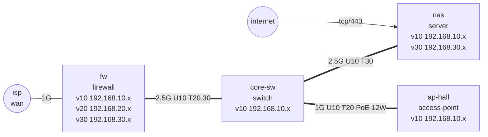

# lab-truth-map

**English** | [中文](README.zh-CN.md)

An agent skill for mapping a homelab or small-office network **as it really is**, not as you remember it.

Your agent surveys the network read-only, grades every fact as `SEEN`, `TOLD` or `GUESS`, writes everything into one inventory file, lints that file for contradictions, and only then draws the diagram. The result is a verdict you can trust: **TRUE**, **DRIFT** or **CONFLICT**, plus a diagram that is redacted by default so you can post it.

## Why

Hand-drawn network diagrams rot. Static IPs end up inside DHCP pools, the two ends of a trunk carry different VLANs, a 2.5G link quietly negotiates 1G, a forgotten port forward still points at an old server, and the image you post online shows your real domain. This skill catches those before they end up in the picture.

## Features

- **Read-only survey order**: internet edge, firewall, switches, access points, servers, important end devices.
- **Evidence grades** on every device (`SEEN` with a named source, `TOLD`, `GUESS`) and a staleness check.
- **Both-ends link records**: speed, expected speed, PoE watts and VLANs as configured on each end.
- **Ten lint rules** (`L01`-`L10`): duplicate addresses, static-in-pool, address outside subnet, VLAN mismatch across a cable, link speed problems, PoE budget, undeclared or unexplained internet exposure, missing evidence, orphan devices, stale facts.
- **Clear verdicts**: TRUE / DRIFT / CONFLICT, with exit codes 0 / 1 / 2 for scripts and CI.
- **Mermaid diagram generator**: trunks thick, wireless dotted, speed and PoE on each cable, exposure arrows from the internet, unconfirmed devices labelled, private addresses masked and domain replaced unless you opt out.
- **Open-question list** so the agent asks instead of filling gaps.
- Zero dependencies (Python 3 standard library). YAML input works if PyYAML is installed.

## Install

The skill is the folder itself: `SKILL.md` plus `scripts/`.

**Claude Code**
```bash
git clone https://github.com/fangdididi/lab-truth-map ~/.claude/skills/lab-truth-map
```

**Codex / other agents that read `AGENTS.md` or skill folders**
```bash
git clone https://github.com/fangdididi/lab-truth-map ~/.agents/skills/lab-truth-map
```
Then point your agent at `SKILL.md` (for example, mention it in `AGENTS.md`).

**Cursor**
Clone into your project (for example `.cursor/skills/lab-truth-map`) and reference `SKILL.md` from a rule, or just ask the agent to read it.

## Usage

Ask your agent things like:

- "Map my home network and draw it so I can post it on r/homelab."
- "Before I add an IoT VLAN, document what we have now."
- "Check whether anything is open to the internet that shouldn't be."

The helper script can also be used on its own:

```bash
python3 scripts/labmap.py check   inventory.json      # findings + verdict
python3 scripts/labmap.py ask     inventory.json      # open questions
python3 scripts/labmap.py mermaid inventory.json      # redacted diagram
python3 scripts/labmap.py mermaid inventory.json --show-private   # private copy
```

## Example

```text
$ python3 scripts/labmap.py check examples/messy.json
ERROR L02  nas: static 192.168.10.150 sits inside the DHCP pool 192.168.10.100-192.168.10.199
ERROR L01  192.168.10.2 on VLAN 10 is claimed by both core-sw and ap-hall
ERROR L03  printer: 192.168.21.5 is outside VLAN 20 (192.168.20.0/24)
ERROR L04  core-sw:2 <-> nas:eth0: the two ends disagree on VLANs ...
WARN  L06  core-sw: PoE draw 60 W is above 80% of 65 W
ERROR L07  WAN port 8080 forwards to core-sw:80, which is not on the exposed list
...
VERDICT: CONFLICT  (5 errors, 5 warnings)
```



## Inventory format (short)

```json
{
  "domain": "home.arpa",
  "vlans":   [{"id": 10, "subnet": "192.168.10.0/24", "dhcp": ["192.168.10.100", "192.168.10.199"]}],
  "devices": [{"name": "nas", "kind": "server", "ports": [{"id": "eth0", "max_mbps": 2500}],
               "ip": [{"vlan": 10, "addr": "192.168.10.10"}],
               "evidence": {"grade": "SEEN", "source": "ip -br addr", "date": "2026-11-08"}}],
  "links":   [{"a": "core-sw:2", "b": "nas:eth0", "speed_mbps": 2500, "expected_mbps": 2500,
               "a_vlans": {"untagged": 10, "tagged": [30]}, "b_vlans": {"untagged": 10, "tagged": [30]}}],
  "exposed": [{"device": "nas", "port": 443, "proto": "tcp", "reason": "photo sharing behind login"}],
  "forwards":[{"wan_port": 443, "to": "nas", "to_port": 443}]
}
```

Optional fields: `mode: "reserved"` on an address, `poe_budget_w` on a switch, `poe_w` and `wireless` on a link, `via` on an exposed entry reached by tunnel. Full examples are in `examples/`.

## File structure

```text
lab-truth-map/
├── SKILL.md             # skill instructions (English)
├── SKILL.zh-CN.md       # skill instructions (Chinese)
├── README.md            # this file
├── README.zh-CN.md      # Chinese README
├── scripts/labmap.py    # lint, open questions, Mermaid diagram
├── examples/clean.json  # an inventory that passes (TRUE)
├── examples/messy.json  # an inventory with problems (CONFLICT)
├── tests/test_labmap.py # 29 unit tests
└── LICENSE
```

Run the tests with `python3 -m unittest discover -s tests`.

## License

MIT, see [LICENSE](LICENSE).
