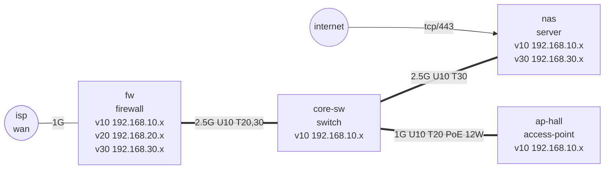

# lab-truth-map（网络实况图）

[English](README.md) | **中文**

一个智能体技能：按网络**真实的样子**绘制家庭实验室（homelab）或小办公室网络，而不是按你记忆中的样子。

智能体以只读方式勘查网络，给每条事实标上 `SEEN`、`TOLD` 或 `GUESS` 等级，把一切写进一份清单文件，检查文件里的矛盾，最后才画图。你得到一个可信的结论：**TRUE**、**DRIFT** 或 **CONFLICT**，外加一张默认脱敏、可以直接发帖的拓扑图。

## 为什么需要它

手画的网络图会“腐烂”：固定 IP 跑进了 DHCP 池，Trunk 两端的 VLAN 不一样，2.5G 链路悄悄协商成 1G，被遗忘的端口转发还指着旧服务器，发到网上的图里露出了真实域名。这个技能在这些问题被画进图之前就把它们抓出来。

## 功能

- **只读勘查顺序**：公网边界 → 防火墙 → 交换机 → AP → 服务器 → 重要终端。
- **证据等级**：每台设备都有 `SEEN`（写明来源）、`TOLD`、`GUESS`，并检查是否过期。
- **链路两端分别记录**：速率、期望速率、PoE 瓦数，以及两端各自配置的 VLAN。
- **十条检查规则**（`L01`–`L10`）：重复地址、固定地址落入地址池、地址不在网段内、网线两端 VLAN 不一致、链路速率问题、PoE 预算、未声明或没理由的公网暴露、缺少证据、孤立设备、过期事实。
- **明确结论**：TRUE / DRIFT / CONFLICT，脚本退出码 0 / 1 / 2，方便接入脚本和 CI。
- **Mermaid 拓扑图生成**：Trunk 粗线、无线虚线、每根线标速率和 PoE、公网暴露画成箭头、未确认设备单独标注；默认遮蔽内网地址并替换域名。
- **待确认问题列表**：让智能体去问，而不是自己编。
- 零依赖（仅 Python 3 标准库）。安装 PyYAML 后也可以用 YAML 清单。

## 安装

技能就是这个文件夹本身：`SKILL.md` 加 `scripts/`。

**Claude Code**
```bash
git clone https://github.com/fangdididi/lab-truth-map ~/.claude/skills/lab-truth-map
```

**Codex / 其他读取 `AGENTS.md` 或技能目录的智能体**
```bash
git clone https://github.com/fangdididi/lab-truth-map ~/.agents/skills/lab-truth-map
```
然后让智能体知道 `SKILL.md` 的位置（例如在 `AGENTS.md` 里提一句）。

**Cursor**
克隆到项目里（例如 `.cursor/skills/lab-truth-map`），在规则里引用 `SKILL.md`，或者直接让智能体去读它。

## 使用

可以这样对智能体说：

- “把我家的网络摸一遍，画一张能发 r/homelab 的图。”
- “加 IoT VLAN 之前，先把现状记录下来。”
- “检查一下有没有不该暴露到公网的东西。”

辅助脚本也可以单独使用：

```bash
python3 scripts/labmap.py check   inventory.json      # 问题列表 + 结论
python3 scripts/labmap.py ask     inventory.json      # 待确认问题
python3 scripts/labmap.py mermaid inventory.json      # 脱敏拓扑图
python3 scripts/labmap.py mermaid inventory.json --show-private   # 私用版本
```

## 示例

```text
$ python3 scripts/labmap.py check examples/messy.json
ERROR L02  nas: static 192.168.10.150 sits inside the DHCP pool 192.168.10.100-192.168.10.199
ERROR L01  192.168.10.2 on VLAN 10 is claimed by both core-sw and ap-hall
ERROR L03  printer: 192.168.21.5 is outside VLAN 20 (192.168.20.0/24)
ERROR L04  core-sw:2 <-> nas:eth0: the two ends disagree on VLANs ...
WARN  L06  core-sw: PoE draw 60 W is above 80% of 65 W
ERROR L07  WAN port 8080 forwards to core-sw:80, which is not on the exposed list
...
VERDICT: CONFLICT  (5 errors, 5 warnings)
```

`examples/clean.json` 生成的图：



## 清单格式（简版）

```json
{
  "domain": "home.arpa",
  "vlans":   [{"id": 10, "subnet": "192.168.10.0/24", "dhcp": ["192.168.10.100", "192.168.10.199"]}],
  "devices": [{"name": "nas", "kind": "server", "ports": [{"id": "eth0", "max_mbps": 2500}],
               "ip": [{"vlan": 10, "addr": "192.168.10.10"}],
               "evidence": {"grade": "SEEN", "source": "ip -br addr", "date": "2026-11-08"}}],
  "links":   [{"a": "core-sw:2", "b": "nas:eth0", "speed_mbps": 2500, "expected_mbps": 2500,
               "a_vlans": {"untagged": 10, "tagged": [30]}, "b_vlans": {"untagged": 10, "tagged": [30]}}],
  "exposed": [{"device": "nas", "port": 443, "proto": "tcp", "reason": "相册分享，需登录"}],
  "forwards":[{"wan_port": 443, "to": "nas", "to_port": 443}]
}
```

可选字段：地址上的 `mode: "reserved"`、交换机上的 `poe_budget_w`、链路上的 `poe_w` 和 `wireless`、通过隧道访问的暴露项上的 `via`。完整示例见 `examples/`。

## 文件结构

```text
lab-truth-map/
├── SKILL.md             # 技能说明（英文）
├── SKILL.zh-CN.md       # 技能说明（中文）
├── README.md            # 英文 README
├── README.zh-CN.md      # 本文件
├── scripts/labmap.py    # 检查、待确认问题、Mermaid 拓扑图
├── examples/clean.json  # 通过检查的清单（TRUE）
├── examples/messy.json  # 有问题的清单（CONFLICT）
├── tests/test_labmap.py # 29 个单元测试
└── LICENSE
```

运行测试：`python3 -m unittest discover -s tests`。

## 许可证

MIT，见 [LICENSE](LICENSE)。
